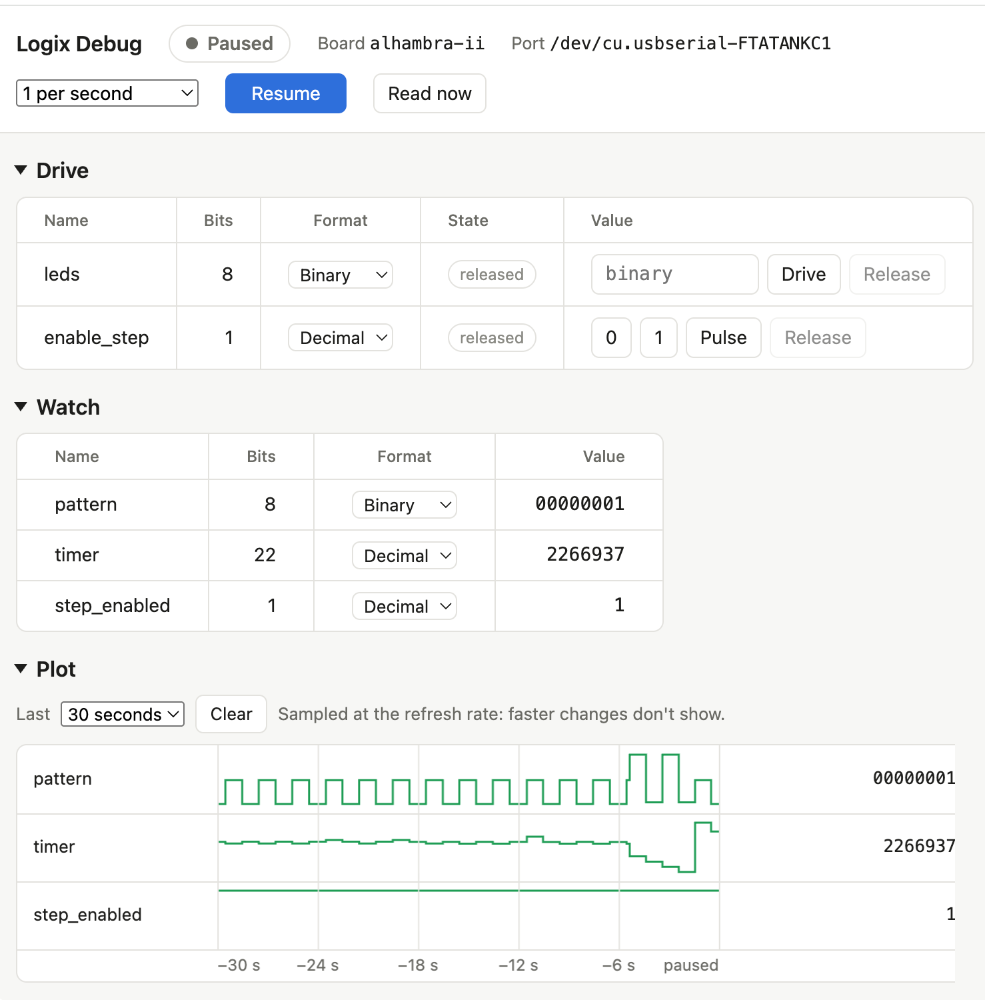

# Tutorial: debug a running light on the Alhambra II

This tutorial takes you from a fresh copy of this repo to a design running on
an [Alhambra II](https://alhambrabits.com/alhambra/) board, with its signals
live in your browser. You'll install the tools, build soft-agent (Logix
Engine with the debugger added), program the board, and then watch and drive
the design while it runs.

Everything happens in a terminal, through two scripts. No AI agent is
involved at any step.

It takes about 20 to 40 minutes the first time, mostly downloading. After
that, running the example takes under a minute.

## Before you start

You need:

- **A Mac with Apple Silicon** (M1 or later). soft-agent runs only there for
  now. To check, open the Apple menu, then About This Mac: the Chip line
  says Apple M-something.
- **This repo on your computer**, cloned with git or downloaded as a ZIP
  from GitHub and unpacked.
- **An Alhambra II, connected with its USB cable.** Its power LED should be
  on. Some USB cables carry power only: if nothing works later, try another
  cable.
- **About 5 GB of free disk:** 3 GB for the FPGA toolchain and 1 GB for the
  Rust build.
- **An internet connection**, and your Mac's password, if Homebrew isn't
  installed yet.

macOS needs no driver for the Alhambra II: it works as soon as it's plugged
in.

## Step 1: Open a terminal in the repo

Open the Terminal app (in Applications, Utilities, or search for it with
Cmd-Space). Then go to the repo's folder. For example, if you cloned it into
your home folder:

```bash
cd ~/soft-agent
```

Tip: type `cd ` (with the space), drag the repo's folder from Finder into the
Terminal window, and press Return.

Every command below runs from this folder.

## Step 2: Install the tools

Run:

```bash
./install-deps.sh
```

It installs, in order, only what's missing:

1. **Apple's command line tools:** git, Python 3, and the linker Rust needs.
   If they're missing, macOS opens a window asking to install them. Click
   Install, wait until it finishes (a few minutes), then run
   `./install-deps.sh` again.
2. **Homebrew**, the package manager Rust is installed with. If it's
   missing, the script asks `Install Homebrew now? [y/N]`. Type `y`, press
   Return, and type your Mac's password when Homebrew asks. Nothing shows
   while you type it.
3. **rustup** and the Rust version this repo uses.
4. **soft-agent**, built from this repo. This takes a few minutes the first
   time. The program is copied to `~/.logix/soft-agent/engine-program`.
5. **The FPGA toolchain** (yosys, nextpnr, the programmer and the rest),
   about 3 GB, into `~/.logix/soft-agent/engine-data`. This is the longest
   step.

When it's done, it ends with:

```text
== Done
Connect an Alhambra II and run: examples/alhambra1/run.sh
```

If a step stops, for example because the network dropped, run
`./install-deps.sh` again. It skips whatever is already in place and
continues from where it stopped.

## Step 3: Build, program and open the panel

With the board connected, run:

```bash
examples/alhambra1/run.sh
```

It names each step as it goes:

```text
== Building soft-agent (the first time takes a few minutes)
== Checking the toolchain
Ready.

== Building main for the alhambra-ii with the debugger
The design uses 946 of 7680 logic cells (13%).
The design uses 1 of 32 RAM blocks (4%).
The design uses 11 of 107 I/O pins (11%).
Maximum clock speed: 69.5 MHz (sys_clk).
The debugger uses about 544 LUTs (8%) and 320 flip-flops (5%) of the FPGA's 7680 logic cells.
Build ID 41e100c9: drives leds, enable_step; watches pattern, timer, step_enabled.

== Programming the board
Done.

== Opening the debug panel
Session debug1 on /dev/cu.usbserial-…, build 41e100c9
Panel: http://127.0.0.1:…
Press Enter to close the session (or Ctrl-C)...
```

Your numbers, build ID and port name may differ.

What it did:

1. **Rebuilt soft-agent** if the repo changed since the last build. This
   takes seconds.
2. **Checked the FPGA toolchain.** It downloads anything that's missing.
3. **Built the design with the debugger.** It read `main.v`, the design,
   and `debug.toml`, which says which signals to watch and drive. It added
   the debugger's hardware to the design and built the result into
   `examples/alhambra1/_build_debug`. The report shows how much of the FPGA
   the design uses, and how much of that is the debugger.
4. **Programmed the board.** One of the eight LEDs lights up and moves along
   the row, four steps a second.
5. **Opened the debug panel** in your browser, connected to the debugger
   on the board over the same USB cable.

Leave the terminal as it is: the panel works as long as `run.sh` is waiting
there.

## Step 4: Explore the panel

The panel has three sections: **Drive**, the signals you can set; **Watch**,
the signals the panel reads, refreshed live; and **Plot**, the watched
signals drawn over time.



Try these:

- **Watch the light.** In Watch, `pattern` is the lit LED, in binary (LED7
  first). `timer` counts to 3,000,000 four times a second. `step_enabled`
  shows what the design sees of `enable_step`: 1, unless you drive it to 0.
- **Hold the light.** In Drive, click **0** on the `enable_step` row. The
  light stops where it is, and `step_enabled` in Watch shows 0.
- **Step it by hand.** While the light is held, click **Pulse** on the
  `enable_step` row. `enable_step` becomes 1 for a single clock cycle, and
  the light moves one place. The row's state flashes when the board has
  taken the pulse. Click **Release** to give `enable_step` back to the
  design, and the light runs again.
- **Take over the LEDs.** On the `leds` row, type a pattern such as
  `10101010` (binary, one digit per LED, LED7 first) and click **Drive**.
  The LEDs show your pattern. Click **Release** to give them back: the light
  carries on from your pattern, because driving the LEDs also feeds the
  register that holds them.
- **Change formats.** Each row's **Format** menu switches its value between
  hex, decimal and binary.
- **Use the plot.** Set the refresh rate to 20 or 50 per second for smoother
  lines, and point at the plot to see the values at any moment. A pulse
  lasts one clock, far shorter than the time between reads, so it doesn't
  show there, but its effect on `pattern` does.
- **Pause and read once.** **Pause** stops the live updates and freezes the
  plot; **Read now** reads once.

## Step 5: Stop

Press Return in the terminal. The script releases every signal you drove,
so the design runs on its own again, and frees the board's serial port:

```text
Closed; overrides released.
```

The board keeps running the debug build until you program something else
or unplug it.

## Step 6: Watch another signal

The debugger can watch any signal in the design, by its path from the top
module, `main`. Try one that isn't watched yet: `due`, which is 1 while a
step is waiting for `enable_step`.

Open `examples/alhambra1/debug.toml` in a text editor, and add at the end:

```toml
[[watch]]
name = "due"
net = "main.due"
```

Save it and run `examples/alhambra1/run.sh` again. The debugger is rebuilt
to match, and the panel shows `due` in Watch. Hold the light with
`enable_step` at 0: `due` turns 1 at the next step and stays 1 until you
pulse or release `enable_step`.

The file's format is described in
[docs/debugger.md](../../docs/debugger.md), The debug configuration file.

## Step 7: Reopen the panel without rebuilding

If the board is still running the debug build, you can open the panel again
without building or programming:

```bash
scripts/debug-panel.sh examples/alhambra1/_build_debug
```

It checks that the board runs that build, and refuses otherwise. As before,
press Return in the terminal to close it.

## If something goes wrong

- **"this script is for macOS" or "this Mac has an Intel processor"**:
  soft-agent runs only on Macs with Apple Silicon for now.
- **"No board found"**: check the USB cable (try another one; some carry
  power only) and that the board's power LED is on.
- **"Can't open /dev/cu.usbserial-…"** or **"Device or resource busy"**:
  another program has the board's serial port. It may be a serial monitor,
  or an earlier `run.sh` or `debug-panel.sh` still waiting for Return in
  another terminal window. Close it and try again.
- **The panel says "soft-agent stopped"**: `run.sh` ended in the terminal.
  Run it again.
- **The panel says the debugger didn't answer**: the board was unplugged or
  programmed with another design. Plug it back in, and the panel resumes by
  itself; or run `run.sh` again.
- **"The board runs another debug build"** from `debug-panel.sh`: the
  board was programmed with something else since `run.sh`. Run `examples/alhambra1/run.sh`, which programs it again.

## Removing it all

To remove what the tutorial installed:

- soft-agent and the FPGA toolchain: delete `~/.logix/soft-agent`.
- The Rust build: delete the repo's `target` folder, or the whole repo.
- Rust: `brew uninstall rustup`, then delete `~/.rustup`.
- Homebrew and Apple's command line tools: other programs may use them, so
  keep them unless you know they're not needed. See
  [brew.sh](https://brew.sh) for how to uninstall Homebrew.
